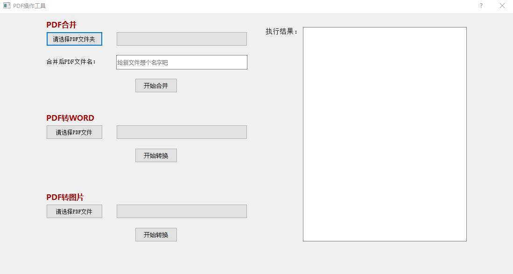
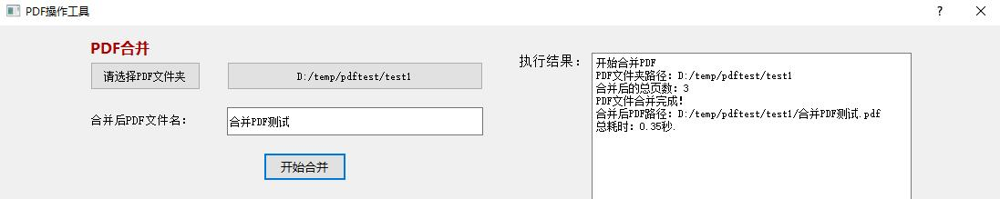
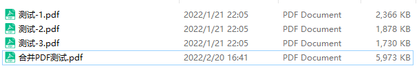
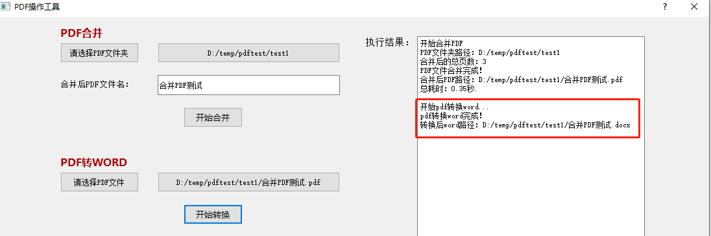
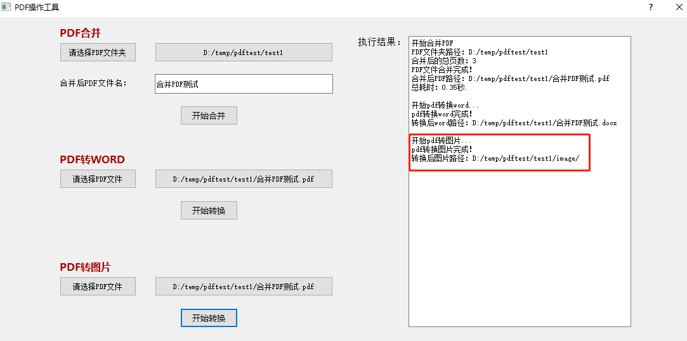
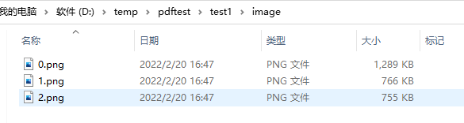

# pdftools2
## 1、实现功能：
多个PDF文件合并、PDF转WORD、PDF转图片
## 2、写这个工具的缘由：
给我对象用，平时我也用不着。大家有需要的自取，安装包以打包好。
## 3、运行环境：
python3.10 + Windows 10/11 或 macOS 10.15+
## 4、使用前准备：
执行命令：
```bash
pip install -r requirements.txt
```
## 5、使用介绍：
- Windows：双击执行 `PDF工具.vbs`，或命令行运行 `python pdftools.py`
- macOS：命令行运行 `python3 pdftools.py`

总体效果图：


PDF合并功能：
选择PDF所在文件夹，给合并后的pdf文件起个名字，点击开始合并：


合并后结果：



PDF转WORD功能:
选择PDF文件，点击开始转换：


转换后结果：


PDF转图片功能：
选择PDF文件，点击开始转换，结果存放在image目录下：


转换后结果：



## 6、打包成可执行文件：
先安装依赖（Windows / macOS 相同）：
```bash
pip install -r requirements.txt
```

### Windows（生成 `dist\PDFTools.exe`）
方式一：双击运行 `build_exe.bat`

方式二：在项目根目录执行：
```powershell
python -m PyInstaller --noconfirm --clean pdftools.spec
```
产物路径：`dist\PDFTools.exe`（已做体积优化，裁掉未使用的 Qt / OpenCV 视频库等，不影响功能）

### macOS（生成 `dist/PDFTools.app`）
在 **Mac 本机**（或 CI 的 macOS 环境）进入项目根目录执行：
```bash
export MACOSX_DEPLOYMENT_TARGET=10.15
python3 -m PyInstaller --noconfirm --clean --windowed --name PDFTools --exclude-module tkinter pdftools.py
```
产物路径：`dist/PDFTools.app`

说明：
- Windows 的 `.exe` 不能在 Mac 上运行，需分别在对应系统上打包
- 打包配置文件使用英文名 `pdftools.spec`，避免 GitHub Actions 等环境因中文文件名找不到
- Mac 首次打开未签名应用时，若被拦截，可在「隐私与安全性」中允许，或右键 → 打开
- 若 GitHub Actions 上传失败提示 `Artifact storage quota has been hit`：到仓库 **Actions** 页删除旧的 Artifacts，等待 6–12 小时配额刷新后再跑
